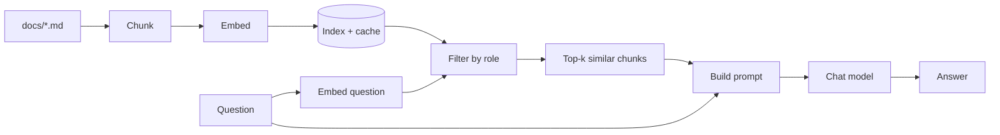

# RAG from scratch: a beginner-friendly walkthrough

A tiny chatbot that answers questions about your own documents using AI models running **locally** on your computer (via [Ollama](https://ollama.com)). No cloud, no API keys, light models only (`nomic-embed-text` and `qwen3:4b-instruct`), and a few hundred commented lines of code.

> **RAG** = **R**etrieval-**A**ugmented **G**eneration.
> A language model doesn't know your private documents. So before asking it a question, we *retrieve* the relevant paragraphs and paste them into the prompt. The model then *generates* an answer from that evidence.

## The big picture

```
 ┌─────────────────────────── ONCE (at startup, cached) ───────────────────────────┐
 │                                                                                  │
 │   docs/*.md ──► 1. CHUNK ──► 2. EMBED ──► 3. STORE                               │
 │   (your files)   split into    text → list   vectors + chunks                    │
 │                  paragraphs    of numbers    saved in .cache/index.npz           │
 └──────────────────────────────────────────────────────────────────────────────────┘

 ┌────────────────────────── FOR EVERY QUESTION ────────────────────────────────────┐
 │                                                                                  │
 │  "When do you open?"                                                             │
 │        │                                                                         │
 │        ▼                                                                         │
 │   4. EMBED the question ──► 5. FILTER by role ──► 6. SCORE & pick top 5 chunks   │
 │                              (hide internal        (similarity of vectors)       │
 │                               chunks from                  │                     │
 │                               customers)                   ▼                     │
 │                                              7. PROMPT = rules + chunks + question│
 │                                                            │                     │
 │                                                            ▼                     │
 │                                              8. CHAT MODEL writes the answer     │
 └──────────────────────────────────────────────────────────────────────────────────┘
```

The same flow as a diagram (renders on GitHub and in VS Code's Markdown preview):



## Quick start

1. Install [Ollama](https://ollama.com) and download the two models:
   ```
   ollama pull nomic-embed-text
   ollama pull qwen3:4b-instruct
   ```
2. Install dependencies and run (from the project folder):
   ```
   uv sync
   uv run python -m rag_project.rag --role public      # you are a customer
   uv run python -m rag_project.rag --role internal     # you are an employee
   ```
3. Try the same question in both roles and compare (the corpus is the fictional **Home University**, see below):
   - `What is the server room access method?` → public: *"I don't know"*, internal: staff card + PIN
   - `What is the pass mark for an exam?` → both get *5.5*, with sources listed under the answer

Options: `--rebuild` (ignore cache), `--hide-context` (don't print retrieved chunks).

Run the tests (no Ollama needed): `uv run python -m unittest discover tests`
Measure retrieval quality (needs Ollama): `uv run python -m rag_project.evaluate --ablate`

## Re-ranking

Embedding search is fast but coarse, so the best candidates are re-read together with the question (`src/rag_project/rerank.py`). The default is `hybrid`: a small cross-encoder (`bge-reranker-base`) reads 20 candidates, then the chat model rates the best 6. It needs the optional extra: `uv sync --extra rerank`. Set `RERANKER = "none"` in `config.py` for the fastest plain search, or pass `--rerank` choices to the evaluator to compare. Measured on 60 answerable questions:

| Setup | Easy R@1 | Hard R@3 | Hard MRR | Speed per question |
|---|---|---|---|---|
| none | 0.95 | 0.71 | 0.71 | instant |
| bge | 0.90 | 0.86 | 0.75 | ~1.5 s |
| bge-m3 | 0.97 | 0.81 | 0.72 | a few s |
| judge | 0.97 | 0.90 | 0.73 | ~36 s |
| **hybrid** | 0.97 | 0.90 | 0.78 | ~5 s |

`RERANK_THRESHOLD = 0.30` turns away some unanswerable questions without rejecting any answerable one.

## Vector store: NumPy or Qdrant

The store is picked automatically from the corpus size. Below `QDRANT_MIN_CHUNKS` (in `config.py`) search is an exact NumPy matrix product, ideal for small corpora. At or above it, vectors live in an on-disk Qdrant collection ([vectorstore.py](src/rag_project/vectorstore.py), embedded mode, no server; set `QDRANT_URL` for a real one) and the role filter is applied inside the database query. That one number is the only control; it is currently low (300, the corpus has ~400 chunks) so Qdrant gets exercised, and is meant to be raised later. `evaluate --compare-stores` scores the store that was not selected, to check both agree.

## The corpus: Home University

`docs/` holds a multimodal knowledge base for a fictional Dutch university (Amersfoort). Files in `docs/public/` are visible to everyone; files in `docs/internal/` only to the `internal` role.

| Modality | Examples |
|---|---|
| Structured text | OER (exam regulations), academic calendar, tuition and scholarships, student handbook (Markdown); research data policy (HTML) |
| Tables | fee tables, calendar, salary scales; `course_catalogue.csv` and `enrolment_statistics.csv` (one chunk per row) |
| PDF | a generated annual report (text, finance table, charts) and the real paper *Lost in the Middle* (a messy two-column PDF, also a distractor) |
| Images | a campus map, two charts, four CC-licensed photos; each is searchable through a text description (`<name>.alt.txt`, or a vision model if `VISION_MODEL` is set in config) |
| Code | `internal/timetable_export.py`, chunked per function with the `ast` module |

The synthetic assets are rebuilt by `scripts/build_corpus_assets.py`; third-party material is credited in [ATTRIBUTION.md](ATTRIBUTION.md).

## Where to read the code

Read the files in pipeline order. Each starts with a docstring that explains the idea.

| Order | File | Pipeline step | Key idea |
|---|---|---|---|
| 1 | [config.py](src/rag_project/config.py) | settings | all the knobs in one place |
| 2 | [chunking.py](src/rag_project/chunking.py) | 1. Chunk | heading paths, small children + big parents, access tags |
| 3 | [loaders.py](src/rag_project/loaders.py) | 1. Chunk | one loader per file type (md, html, csv, pdf, py, images) |
| 4 | [ollama_client.py](src/rag_project/ollama_client.py) | 2/4/8. Talk to models | embeddings, chat, vision, batching, clear errors |
| 5 | [index.py](src/rag_project/index.py) | 2-3. Embed & store | normalization, nomic prefixes, caching with a fingerprint |
| 6 | [retrieval.py](src/rag_project/retrieval.py) | 5-6. Filter & search | access filtering, cosine similarity, parent expansion, threshold, U-shaped order |
| 7 | [rag.py](src/rag_project/rag.py) | 7-8. Prompt & answer | the prompt, sources, the chat loop |
| 8 | [evaluate.py](src/rag_project/evaluate.py) | measuring | Recall@k, MRR, leak test, threshold calibration |

More reading in [guide/](guide/):
- [guide/concepts.md](guide/concepts.md): embeddings, cosine similarity and chunking explained with small examples
- [guide/walkthrough.md](guide/walkthrough.md): one question traced through the whole system
- [guide/changes.md](guide/changes.md): what changed from the original single-file script, and why
- [guide/next-steps.md](guide/next-steps.md): ideas to extend the project

## Adding your own documents

Drop files into `docs/public/` or `docs/internal/` (`.md .html .csv .pdf .py .png .jpg`). The folder sets the default access level. In Markdown you can override it per paragraph:

```markdown
<!-- access: internal -->
The alarm code is 4417.
```

A file outside those two folders is treated as **internal**, so a misplaced file is hidden instead of leaked. The cache refreshes by itself when the files change.

> `src/rag_project/expense.py` is an unrelated budget script from earlier. It isn't part of the RAG pipeline.
