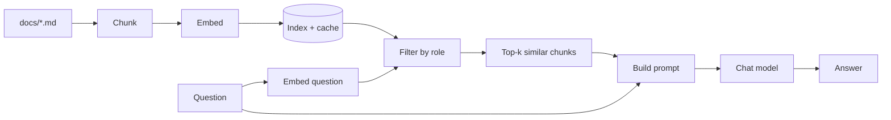

# RAG from scratch: a beginner-friendly walkthrough

A tiny chatbot that answers questions about your own documents using AI models running **locally** on your computer (via [Ollama](https://ollama.com)). No cloud, no API keys, and only about 300 lines of code, all commented.

> **RAG** = **R**etrieval-**A**ugmented **G**eneration.
> A language model doesn't know your private documents. So before asking it a question, we *retrieve* the relevant paragraphs and paste them into the prompt. The model then *generates* an answer from that evidence.

## The big picture

```
 ┌─────────────────────────── ONCE (at startup, cached) ───────────────────────────┐
 │                                                                                  │
 │   docs/*.md ──► 1. CHUNK ──► 2. EMBED ──► 3. STORE                               │
 │   (your files)   split into    text → list   vectors + chunks                    │
 │                  paragraphs    of numbers    saved in .cache/index.npz           │
 └──────────────────────────────────────────────────────────────────────────────────┘

 ┌────────────────────────── FOR EVERY QUESTION ────────────────────────────────────┐
 │                                                                                  │
 │  "When do you open?"                                                             │
 │        │                                                                         │
 │        ▼                                                                         │
 │   4. EMBED the question ──► 5. FILTER by role ──► 6. SCORE & pick top 5 chunks   │
 │                              (hide internal        (similarity of vectors)       │
 │                               chunks from                  │                     │
 │                               customers)                   ▼                     │
 │                                              7. PROMPT = rules + chunks + question│
 │                                                            │                     │
 │                                                            ▼                     │
 │                                              8. CHAT MODEL writes the answer     │
 └──────────────────────────────────────────────────────────────────────────────────┘
```

The same flow as a diagram (renders on GitHub and in VS Code's Markdown preview):



## Quick start

1. Install [Ollama](https://ollama.com) and download the two models:
   ```
   ollama pull nomic-embed-text
   ollama pull qwen3:4b-instruct
   ```
2. Install dependencies and run (from the project folder):
   ```
   uv sync
   uv run python -m rag_project.rag --role public      # you are a customer
   uv run python -m rag_project.rag --role internal     # you are an employee
   ```
3. Try the same question in both roles and compare:
   - `What is the alarm code?` → customer: *"I don't know"*, employee: *4417*
   - `When do you open?` → both get the answer

Options: `--rebuild` (ignore cache), `--hide-context` (don't print retrieved chunks).

Run the tests (no Ollama needed): `uv run python -m unittest discover tests`

## Where to read the code

Read the files in pipeline order. Each starts with a docstring that explains the idea.

| Order | File | Pipeline step | Key idea |
|---|---|---|---|
| 1 | [config.py](src/rag_project/config.py) | settings | all the knobs in one place |
| 2 | [chunking.py](src/rag_project/chunking.py) | 1. Chunk | paragraphs become chunks; access tags |
| 3 | [ollama_client.py](src/rag_project/ollama_client.py) | 2/4/8. Talk to models | embeddings, chat, batching, clear errors |
| 4 | [index.py](src/rag_project/index.py) | 2-3. Embed & store | normalization, caching with a fingerprint |
| 5 | [retrieval.py](src/rag_project/retrieval.py) | 5-6. Filter & search | cosine similarity, access filtering |
| 6 | [rag.py](src/rag_project/rag.py) | 7-8. Prompt & answer | the prompt, the chat loop |

More reading in [guide/](guide/):
- [guide/concepts.md](guide/concepts.md): embeddings, cosine similarity and chunking explained with small examples
- [guide/walkthrough.md](guide/walkthrough.md): one question traced through the whole system
- [guide/changes.md](guide/changes.md): what changed from the original single-file script, and why
- [guide/next-steps.md](guide/next-steps.md): ideas to extend the project

## Adding your own documents

Put `.md` files in [docs/](docs/). Tag each paragraph with who may see it:

```markdown
<!-- access: public -->
Opening hours are 7am to 9pm.

<!-- access: internal -->
The alarm code is 4417.
```

An untagged paragraph is treated as **internal**, so forgetting a tag hides information instead of leaking it. The cache refreshes by itself when the files change.

> `src/rag_project/expense.py` is an unrelated budget script from earlier. It isn't part of the RAG pipeline.
