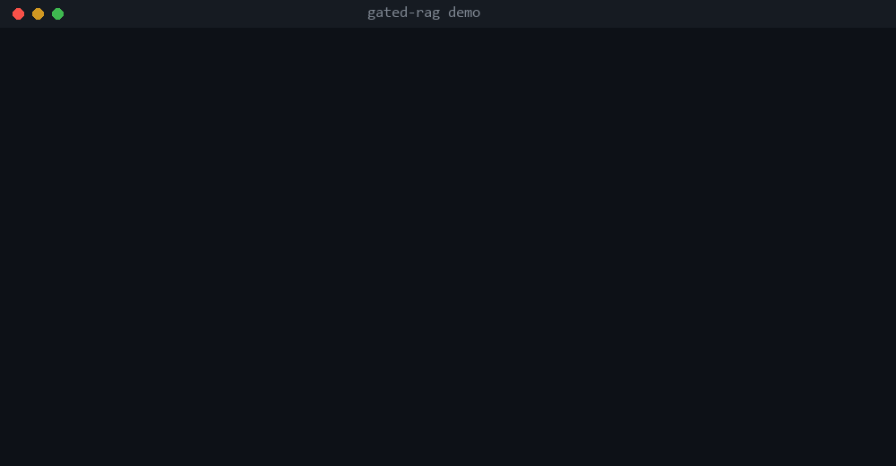
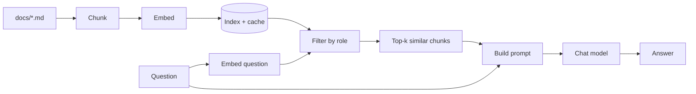

# gated-rag: local RAG that checks who is asking, and measures itself

**A fully local question-answering system over your documents (Markdown, HTML, PDF, CSV, code and images) that you can read in an afternoon, with an evaluation harness that tells you whether each idea actually helped.**

No cloud, no API keys, no LangChain. Runs on a laptop CPU with small [Ollama](https://ollama.com) models (`nomic-embed-text` for search, `qwen3:4b-instruct` for answers).

> **RAG** = **R**etrieval-**A**ugmented **G**eneration. A language model doesn't know your documents, so before asking it a question we *retrieve* the relevant passages and put them in the prompt. It then *generates* an answer from that evidence.



*Real answers from the system. The waiting time is shortened in the animation.*

## Why it's worth a look

- **Access control that can't be talked out of.** Customers must not see internal documents. Instead of asking the model nicely, forbidden chunks are filtered out *before ranking* (inside the database query for Qdrant), so the model never sees them. Untagged content fails closed. Leak-tested: 0 of 11 restricted questions leak, in every setup.
- **Every feature is measured.** `python -m rag_project.evaluate` scores 82 questions (easy and hard, plus restricted and unanswerable ones) with Recall@k, MRR, leak tests and abstention calibration. Several "obvious" ideas lost to the numbers, and the README says so.
- **Structure-aware chunking.** Heading paths (`Handbook > Library > Fees`) are embedded with each chunk, tables and code are never cut in half, and small chunks are searched while the larger parent section goes to the model ("small-to-big").
- **Real multimodal corpus.** A fictional Dutch university ("Home University") with Markdown, HTML, CSV, PDFs (heading and table detection), Python code (split with `ast`) and images (hand-written text or vision-model captions, cached).
- **Two-stage re-ranking, benchmarked.** A cross-encoder reads 20 candidates and the chat model judges the best 6 (`hybrid`). It lifted hard-question Recall@3 from 0.71 to 0.90.
- **Scales without code changes.** The vector store switches from NumPy to Qdrant by corpus size, controlled by one number in `config.py`.
- **Readable.** A few hundred commented lines per file, a docstring on each explaining the idea, and 36 tests that run without Ollama.

### Measured results (60 answerable questions)

| Setup | Easy R@1 | Hard R@3 | Hard MRR | Re-ranking time per question (laptop CPU, uncached) |
|---|---|---|---|---|
| plain embedding search | 0.95 | 0.71 | 0.71 | instant |
| + cross-encoder (`bge`, default) | 0.90 | 0.86 | 0.75 | ~1.5-6 s |
| + LLM judge | 0.97 | 0.90 | 0.73 | ~40-60 s (8 model calls) |
| **+ hybrid (best quality)** | **0.97** | **0.90** | **0.78** | ~35-45 s (6 model calls) |

The judge's verdicts are cached on disk, so a repeated question is free. The speed cost is real: on a CPU, quality costs seconds, so set `RERANKER = "bge"` or `"none"` for snappy chat. Reproduce with `uv run python -m rag_project.evaluate --rerank judge bge bge-m3 hybrid`. Details are in [Re-ranking](#re-ranking).

## The big picture

```
 ┌─────────────────────────── ONCE (at startup, cached) ───────────────────────────┐
 │                                                                                  │
 │   docs/*.md ──► 1. CHUNK ──► 2. EMBED ──► 3. STORE                               │
 │   (your files)   split into    text → list   vectors + chunks                    │
 │                  paragraphs    of numbers    saved in .cache/index.npz           │
 └──────────────────────────────────────────────────────────────────────────────────┘

 ┌────────────────────────── FOR EVERY QUESTION ────────────────────────────────────┐
 │                                                                                  │
 │  "When do you open?"                                                             │
 │        │                                                                         │
 │        ▼                                                                         │
 │   4. EMBED the question ──► 5. FILTER by role ──► 6. SCORE & pick top 5 chunks   │
 │                              (hide internal        (similarity of vectors)       │
 │                               chunks from                  │                     │
 │                               customers)                   ▼                     │
 │                                              7. PROMPT = rules + chunks + question│
 │                                                            │                     │
 │                                                            ▼                     │
 │                                              8. CHAT MODEL writes the answer     │
 └──────────────────────────────────────────────────────────────────────────────────┘
```

The same flow as a diagram (renders on GitHub and in VS Code's Markdown preview):



## Quick start

1. Install [Ollama](https://ollama.com) and download the two models (optionally `qwen2.5vl:3b`, which captions images that have no hand-written description):
   ```
   ollama pull nomic-embed-text
   ollama pull qwen3:4b-instruct
   ```
2. Install [uv](https://docs.astral.sh/uv/) (it provides Python 3.13), clone, install and run:
   ```
   git clone https://github.com/AlgoCodology/gated-rag.git && cd gated-rag
   uv sync --extra rerank          # the extra is the cross-encoder for the default re-ranker
   uv run python -m rag_project.rag --role public      # you are a customer
   uv run python -m rag_project.rag --role internal     # you are an employee
   ```
3. Try the same question in both roles and compare (the corpus is the fictional **Home University**, see below):
   - `What is the server room access method?` → public: *"I don't know"*, internal: staff card + PIN
   - `What is the pass mark for an exam?` → both get *5.5*, with sources listed under the answer

Options: `--rebuild` (ignore cache), `--hide-context` (don't print retrieved chunks), `--rerank none|bge|bge-m3|judge|hybrid` (`none` is fastest, `hybrid` best). The first start embeds the corpus and caches it.

Run the tests (no Ollama needed): `uv run python -m unittest discover tests`
Measure retrieval quality (needs Ollama): `uv run python -m rag_project.evaluate --ablate`

## Re-ranking

Embedding search is fast but coarse, so the best candidates are re-read together with the question (`src/rag_project/rerank.py`). The default is `bge`: a small cross-encoder (`bge-reranker-base`) reads 20 candidates in a few seconds. It needs the optional extra: `uv sync --extra rerank`. Set `RERANKER = "hybrid"` in `config.py` for the best quality (the chat model then also rates the best 6, ~40 s on a CPU), `"none"` for plain search, or pass `--rerank` choices to the evaluator to compare. Measured on 60 answerable questions:

| Setup | Easy R@1 | Hard R@3 | Hard MRR | Re-ranking time per question (laptop CPU, uncached) |
|---|---|---|---|---|
| none | 0.95 | 0.71 | 0.71 | instant |
| bge (default) | 0.90 | 0.86 | 0.75 | ~1.5-6 s |
| bge-m3 | 0.97 | 0.81 | 0.72 | ~3-10 s |
| judge | 0.97 | 0.90 | 0.73 | ~40-60 s (8 model calls) |
| **hybrid** (best quality) | 0.97 | 0.90 | 0.78 | ~35-45 s (6 model calls) |

Abstention is per backend (`RERANK_THRESHOLDS`): hybrid and judge use 0.30, which turns away 4 of 11 unanswerable questions and rejects no answerable one. `bge` has no safe cutoff (its scores overlap), so it only re-orders and never abstains.

## Vector store: NumPy or Qdrant

The store is picked automatically from the corpus size. Below `QDRANT_MIN_CHUNKS` (in `config.py`) search is an exact NumPy matrix product, ideal for small corpora. At or above it, vectors live in an on-disk Qdrant collection ([vectorstore.py](src/rag_project/vectorstore.py), embedded mode, no server; set `QDRANT_URL` for a real one) and the role filter is applied inside the database query. That one number is the only control; it is currently low (300, the corpus has ~400 chunks) so Qdrant gets exercised, and is meant to be raised later. `evaluate --compare-stores` scores the store that was not selected, to check both agree.

## The corpus: Home University

`docs/` holds a multimodal knowledge base for a fictional Dutch university (Amersfoort). Files in `docs/public/` are visible to everyone; files in `docs/internal/` only to the `internal` role.

| Modality | Examples |
|---|---|
| Structured text | OER (exam regulations), academic calendar, tuition and scholarships, student handbook (Markdown); research data policy (HTML) |
| Tables | fee tables, calendar, salary scales; `course_catalogue.csv` and `enrolment_statistics.csv` (one chunk per row) |
| PDF | a generated annual report (text, finance table, charts) and the real paper *Lost in the Middle* (a messy two-column PDF, also a distractor) |
| Images | a campus map, two charts, four CC-licensed photos; each is searchable through a text description (`<name>.alt.txt`, or a vision model if `VISION_MODEL` is set in config) |
| Code | `internal/timetable_export.py`, chunked per function with the `ast` module |

The synthetic assets are rebuilt by `scripts/build_corpus_assets.py`; third-party material is credited in [ATTRIBUTION.md](ATTRIBUTION.md).

## Where to read the code

Read the files in pipeline order. Each starts with a docstring that explains the idea.

| Order | File | Pipeline step | Key idea |
|---|---|---|---|
| 1 | [config.py](src/rag_project/config.py) | settings | all the knobs in one place |
| 2 | [chunking.py](src/rag_project/chunking.py) | 1. Chunk | heading paths, small children + big parents, access tags |
| 3 | [loaders.py](src/rag_project/loaders.py) | 1. Chunk | one loader per file type (md, html, csv, pdf, py, images) |
| 4 | [ollama_client.py](src/rag_project/ollama_client.py) | 2/4/8. Talk to models | embeddings, chat, vision, batching, clear errors |
| 5 | [index.py](src/rag_project/index.py) | 2-3. Embed & store | normalization, nomic prefixes, caching with a fingerprint |
| 6 | [retrieval.py](src/rag_project/retrieval.py) | 5-6. Filter & search | access filtering, cosine similarity, parent expansion, threshold, U-shaped order |
| 6b | [rerank.py](src/rag_project/rerank.py), [vectorstore.py](src/rag_project/vectorstore.py) | 6. Re-rank, store | cross-encoder + LLM judge; NumPy or Qdrant by corpus size |
| 7 | [rag.py](src/rag_project/rag.py) | 7-8. Prompt & answer | the prompt, sources, the chat loop |
| 8 | [evaluate.py](src/rag_project/evaluate.py) | measuring | Recall@k, MRR, leak test, threshold calibration |

More reading in [guide/](guide/):
- [guide/concepts.md](guide/concepts.md): embeddings, cosine similarity and chunking explained with small examples
- [guide/walkthrough.md](guide/walkthrough.md): one question traced through the whole system
- [guide/changes.md](guide/changes.md): what changed from the original single-file script, and why
- [guide/next-steps.md](guide/next-steps.md): ideas to extend the project

## Adding your own documents

Drop files into `docs/public/` or `docs/internal/` (`.md .html .csv .pdf .py .png .jpg`). The folder sets the default access level. In Markdown you can override it per paragraph:

```markdown
<!-- access: internal -->
The alarm code is 4417.
```

A file outside those two folders is treated as **internal**, so a misplaced file is hidden instead of leaked. The cache refreshes by itself when the files change.

## Contributing

Issues and pull requests are welcome, especially new documents for the Home University corpus and new evaluation questions in `eval/questions.jsonl`. Please run `uv run python -m unittest discover tests` first, and `evaluate` if you touch retrieval, so a change comes with numbers.

## License

[MIT](LICENSE). Third-party images and the *Lost in the Middle* paper keep their own licences, see [ATTRIBUTION.md](ATTRIBUTION.md).
